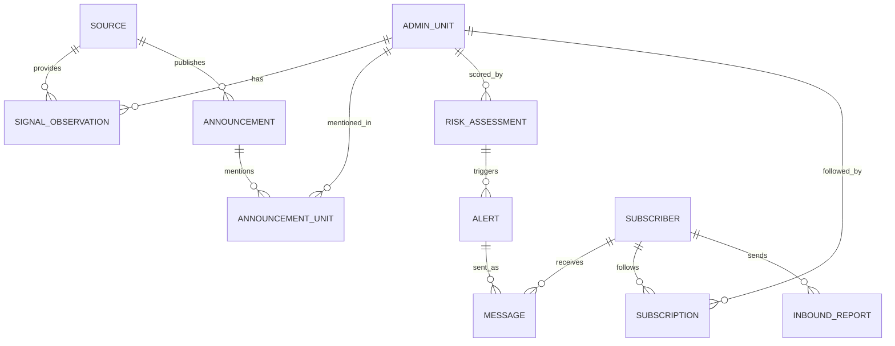

# SMS Shortage Early Warning — Project Spec

Oct 16, 2026 · @idriss

## Problem definition

Food-shortage signals exist weeks to months ahead, but they sit in satellite archives, PDF bulletins and price databases that farmers, food banks and small NGOs never see. We fuse those sources into a district-level shortage risk and push it as SMS, the one channel that reaches a feature phone on 2G with no data plan.

One-line pitch: a district-level shortage forecast, fused from satellite, weather, price and official sources, delivered by SMS with one concrete action per audience, weeks before a crisis is declared.

### Targeted technical problem

- Signals are fragmented: vegetation and rainfall anomalies (raster), government and FEWS NET announcements (unstructured text, often PDF, often French or Arabic), market prices (tabular, irregular).
- Nobody converts them into one per-district risk level with a stated confidence and horizon.
- The last mile is broken: rural users lack smartphones, data and literacy in the bulletin's language.

### Design correction to the original idea

"Send an SMS when the situation is dire" is too late for most users and too vague to act on. The system instead runs tiered alert levels, and each SMS carries one action matched to the recipient.

| Level | Meaning | Who is alerted |
| --- | --- | --- |
| 0 Normal | No anomaly | Nobody (monthly digest optional) |
| 1 Watch | Early anomaly, low confidence | NGOs, food banks, extension officers |
| 2 Warning | Anomaly confirmed by two or more independent sources | All of the above + farmer cooperatives and farmers |
| 3 Emergency | Warning + official declaration or price spike | Everyone subscribed in the district |

### Users and the decision each one makes

| Audience | Decision the SMS improves | Lead time it needs | Example action in the SMS |
| --- | --- | --- | --- |
| Smallholder farmers, cooperatives | Store or sell grain; plant a drought-tolerant variety; sell livestock before prices fall | 1–3 months | Keep 2 months of grain in stock; do not sell maize below the market price |
| Extension officers, agronomists | Which villages to visit; where to send seed and inputs | 1–2 months | Prioritise visits in the 3 named communes |
| Food banks | When to buy stock and how to split it across branches | 4–8 weeks | Increase cereal stock in branch X by Y% |
| NGOs, anticipatory-action funds | Whether to trigger early action and pre-position food or cash | 2–4 months | District reached Warning; P(crisis) and drivers attached |
| Local authorities | Release strategic reserves, adjust subsidies | 1–3 months | Same as NGOs, plus confidence and sources |

### Output per district, per run

Risk level 0–3, probability of a shortage at horizon h, confidence, top three drivers, the sources that agreed, and one recommended action per audience.

### KPIs

| KPI | Target to show at the demo |
| --- | --- |
| Lead time vs official declaration | Weeks gained in a back-tested past crisis |
| Precision and recall of Warning+ alerts | Against FEWS NET / IPC Phase 3+ transitions, vs a persistence baseline |
| False-alarm rate | Share of Warning+ alerts not followed by a shortage |
| Delivery rate, reply rate, opt-out rate | From the SMS gateway logs (simulated at the hackathon) |
| Cost per alerted user per season | SMS volume × unit price |

Fit with the hackathon: this is directly usable for the published Welthungerhilfe drought early-warning case in northern Zimbabwe, which reduces the risk of being judged off-theme.

## Data schema

Everything is keyed on (unit\_id, date). Every source, structured or not, is reduced to rows in one long `signal_observation` table, so adding a source never changes the risk model's interface.

### Entities

| Table | Key columns | Purpose |
| --- | --- | --- |
| `admin_unit` | unit\_id (PK), iso3, adm1, adm2, name, geom, population, cropland\_ha | The spatial key. Every signal and subscriber maps to one unit |
| `source` | source\_id (PK), name, family (eo, weather, market, official\_text, crowd), reliability\_weight, licence, url | Provenance and trust weight per source |
| `signal_observation` | obs\_id (PK), unit\_id (FK), source\_id (FK), signal\_type, value, unit\_of\_measure, period\_start, period\_end, ingested\_at, confidence, raw\_ref | One normalised number per unit, period and signal |
| `announcement` | ann\_id (PK), source\_id (FK), published\_at, language, title, url, text\_hash, extracted\_json, severity (0–3), commodity, extraction\_model, evidence\_span, human\_verified | Government, FEWS NET and NGO text, plus the structured fields an LLM extracted from it |
| `announcement_unit` | ann\_id (FK), unit\_id (FK), match\_score | Which units an announcement refers to, after gazetteer matching |
| `risk_assessment` | assessment\_id (PK), unit\_id (FK), run\_at, horizon\_weeks, p\_shortage, level (0–3), confidence, drivers\_json, n\_sources\_agreeing, model\_version | Output of the fusion model, one row per unit per run |
| `alert` | alert\_id (PK), assessment\_id (FK), unit\_id (FK), level, audience, template\_id, language, status (drafted, approved, sent, cancelled), approved\_by, created\_at, expires\_at | A decision to notify one audience in one unit |
| `subscriber` | subscriber\_id (PK), phone\_enc, phone\_hash, role, language, channel (sms, voice, ussd), min\_level, consent\_at, consent\_source, opted\_out\_at | Who receives what. Phone number encrypted, hash used for joins |
| `subscription` | subscriber\_id (FK), unit\_id (FK) | Many-to-many: a food bank or NGO follows several units |
| `message` | message\_id (PK), alert\_id (FK), subscriber\_id (FK), gateway\_msg\_id, segments, sent\_at, delivery\_status, cost | Outbound log, updated by the gateway's delivery callback |
| `inbound_report` | report\_id (PK), subscriber\_id (FK), unit\_id (FK), received\_at, raw\_text, parsed\_code, parse\_ok | Farmer replies (e.g. 1 = harvest normal, 2 = poor, 3 = failed). Becomes a crowd signal |

### Controlled vocabulary for `signal_type`

| signal\_type | Source | Unit | Direction of risk |
| --- | --- | --- | --- |
| ndvi\_z, evi\_z | Satellite (HLS or MODIS), crop-masked | z-score | Lower = worse |
| spi\_1m, spi\_3m | CHIRPS rainfall | SPI | Lower = worse |
| soil\_moist\_z | ERA5-Land | z-score | Lower = worse |
| price\_anom | WFP market prices | % vs 5-yr seasonal mean | Higher = worse |
| ipc\_phase | FEWS NET | Phase 1–5 | Higher = worse |
| announcement\_severity | Extracted from `announcement` | 0–3 | Higher = worse |
| crowd\_crop\_status | Aggregated `inbound_report` | Share reporting 2 or 3 | Higher = worse |

### Relationships



### Alert contract (what the alert engine hands the message composer)

```json
{
  "alert_id": "ZWE-MSV-2026-03-14-L2-farmer",
  "unit_id": "ZWE.MSV.MBR",
  "level": 2,
  "audience": "farmer",
  "language": "sn",
  "horizon_weeks": 8,
  "p_shortage": 0.68,
  "confidence": "medium",
  "drivers": ["rainfall -45% vs normal", "maize price +32%", "crop greenness lowest in 10 yrs"],
  "action_code": "STORE_GRAIN_2M",
  "expires_at": "2026-04-14"
}
```

The ids and values above are placeholders for the demo, not real data.

### SMS templates (one per audience and level)

A GSM-7 segment holds 160 characters; Arabic, Amharic or any non-Latin script switches to UCS-2 and 70 characters per segment, which roughly doubles cost. Templates are written to fit one segment in the target language.

| Audience | Level | Example (English, before translation) | Length |
| --- | --- | --- | --- |
| Farmer | 2 Warning | WARNING Mbire: rain 45% below normal, poor maize harvest likely. Keep 2 months of grain, avoid selling below market. Reply 1 ok 2 poor 3 failed. STOP to quit | \~155 |
| Food bank | 2 Warning | WARNING Mbire: shortage risk 68% in 8 wks (rain, prices). Consider raising cereal stock now. Details: \[short link\] | \~115 |
| NGO / fund | 1 Watch | WATCH Mbire: P(shortage, 8 wks)=0.41, drivers rain -45%, price +32%. 2 of 4 sources agree. Dashboard: \[short link\] | \~120 |

## Business model canvas

Farmers never pay. Institutions that already fund early warning and anticipatory action pay for the risk feed, the dashboard and the delivery channel; SMS cost is passed through.

| Block | Content |
| --- | --- |
| Customer segments | Paying: NGOs and anticipatory-action funds (e.g. Welthungerhilfe, WFP country offices), food bank networks, government early-warning units and ministries of agriculture, agricultural index insurers. Free users: smallholder farmers, cooperatives, extension officers |
| Value propositions | Farmers: free, local-language alert with one action, on any phone. Food banks: procurement timing weeks earlier. NGOs and funds: a fused, district-level risk with drivers, sources and a back-tested lead time, plus a ready channel to reach beneficiaries. Government: a last-mile dissemination channel for its own bulletins |
| Channels | Bulk and short-code SMS; USSD menu to subscribe and choose district and language; voice (IVR) for low-literacy users; onboarding through cooperatives and extension officers; web dashboard and API for institutions |
| Customer relationships | Explicit opt-in; two-way SMS (replies feed the model); messages sent under a trusted sender ID co-branded with the ministry or partner NGO; human approval before Warning and Emergency |
| Revenue streams | Annual licence per country for dashboard + API (institutions); SMS campaigns billed at cost + margin; grants from climate-adaptation and anticipatory-action funds for the free farmer tier; later, aggregated and anonymised ground-truth data for insurers and researchers |
| Key activities | Ingest and quality-check data; maintain and re-validate the risk model each season; localise templates; onboard subscribers; review alerts; report impact to funders |
| Key resources | The fusion pipeline and risk model; the opted-in subscriber base and its ground-truth replies; translated templates; partner agreements and registered sender IDs |
| Key partners | Mobile operators or SMS aggregators; national meteorological and agriculture agencies; FEWS NET, WFP and ReliefWeb as data sources; implementing NGOs; cooperatives and extension services; food bank networks |
| Cost structure | Variable: SMS segments (the dominant cost at scale). Fixed: cloud compute and storage, model maintenance, localisation, field onboarding, partner management. Earth Engine is free for non-commercial and research use; a commercial deployment needs a paid licence |

### Unit economics (formula; prices to confirm with a gateway quote)

```latex
\text{SMS cost per season} = N_{\text{subscribers}} \times A_{\text{alerts per season}} \times S_{\text{segments per alert}} \times p_{\text{segment}}
```

The number to pitch is the ratio of that cost to the value of acting early: the World Bank estimate used in the earlier brief puts early action at roughly USD 2.8 saved per USD 1 spent. The per-segment price varies by country and operator and must be quoted for the chosen country before it goes on a slide.

## Limitations and risks

The two risks that can sink the pitch are false alarms (trust collapses after two wrong warnings) and market panic (a public shortage forecast can raise prices by itself). Both are handled by design, not by disclaimers.

| Risk | Why it matters | Mitigation |
| --- | --- | --- |
| False alarms and alert fatigue | Recipients ignore or unsubscribe after a few wrong alerts | Escalate only when 2+ independent source families agree; hysteresis (a level must hold for 2 runs to go up, 3 to go down); cap of N messages per subscriber per month; report precision on a back-test |
| Self-fulfilling price spikes and hoarding | Telling traders and the public "shortage coming" can trigger the shortage | Farmers get an action, not a forecast; probabilities go only to NGOs, funds and food banks; public Emergency messages only after an official declaration |
| Authority and liability | An unofficial alert that contradicts government messaging damages trust and invites pushback | Co-sign with the ministry or partner NGO; human approval for level 2+; every alert cites its sources |
| LLM extraction errors on announcements | Wrong district, wrong severity or a hallucinated statement can trigger alerts | Schema-constrained extraction; districts matched to a gazetteer, never free text; each extracted field must quote its evidence span; announcements alone can never raise a level above 1 |
| Language and literacy | Bulletins are in French, Arabic, English; farmers may speak Shona, Darija, Tamazight, Swahili and may not read | Templates translated and checked by native speakers; voice (IVR) channel for low literacy; avoid machine translation of live alerts |
| SMS technical limits | 160 GSM-7 or 70 UCS-2 characters per segment; delivery not guaranteed; shared phones; numbers change | One-segment templates; delivery callbacks logged; re-send policy; extension officers and cooperatives as relays |
| Gateway coverage | Africa's Talking lists Kenya, Uganda, Tanzania, Rwanda, Malawi, Zambia, Nigeria, Côte d'Ivoire, Ethiopia and South Africa, not Zimbabwe or Morocco ([source](https://help.africastalking.com/en/articles/2727792-which-countries-are-africa-s-talking-products-in)) | Use a global gateway (Twilio, Infobip) or a local aggregator for other countries; sender ID registration can take weeks, so plan it early |
| Consent and data protection | Phone number + location + role is personal data under national law (e.g. Morocco Law 09-08, Zimbabwe's Cyber and Data Protection Act) | Explicit opt-in with source logged; STOP keyword; phone numbers encrypted, hashes for joins; minimum data; retention limit |
| Spoofing and gaming | Fake SMS can impersonate the service; farmers may over-report crop failure if they expect aid | Registered sender ID; inbound reports weighted, checked against satellite signal, never the sole trigger |
| Data latency and gaps | FEWS NET skipped cycles in 2025; prices are monthly and sparse; clouds hide crops in the rainy season | Treat missing as missing, not zero; per-source freshness shown on the dashboard; radar (Sentinel-1) as a scale-up |
| Limited validation history | Few labelled crises per country, so skill estimates are noisy | Leave-one-year-out back-test; persistence baseline; report recall on Phase 3+ transitions with the number of events |
| Unequal phone access | Women and the poorest households own fewer phones | Reach through cooperatives, community leaders and extension officers; voice broadcasts |
| Existing services | Farmer SMS advisory services and humanitarian dashboards already exist (e.g. WFP HungerMap LIVE) | Position as the fusion + routing layer that partners plug into; check what exists in the chosen country before claiming novelty |
| Transfer across regions | Thresholds tuned in one agro-climatic zone misfire in another | Calibrate per country and zone; ship with a per-region validation report |

## Hackathon scope

Build one end-to-end slice: one country, three source families, one replayed crisis, real SMS to real phones. Proposed replay: the 2023–24 El Niño drought in Zimbabwe, declared a national disaster on 3 April 2024 ([source](https://www.nbcnews.com/news/world/zimbabwe-el-nino-africa-drought-disaster-humanitarian-aid-rcna146347)), which matches the published Welthungerhilfe case. Zambia (February 2024) and Malawi (March 2024) declared earlier and are fallbacks.

### What is real and what is mocked

| Component | At the demo | Scale-up |
| --- | --- | --- |
| Satellite and weather signal | Real: CHIRPS SPI + MODIS NDVI anomaly over cropland, per district, from Earth Engine (MODIS chosen over HLS for its history back to 2000 and speed) | HLS 30 m, Sentinel-1 radar |
| Prices | Real: WFP market prices from HDX | Live feeds per market |
| Announcements | Real: ReliefWeb API reports for Zimbabwe, Oct 2023–Apr 2024, LLM extraction to the `announcement` schema | National ministry and met-agency sites, radio transcripts |
| Risk model | Weighted rule-based fusion with hysteresis; logistic regression vs persistence if time allows | Calibrated model per country |
| Subscribers | Team members and volunteers who opt in on stage | USSD self-registration via cooperatives |
| SMS | Real messages via a gateway trial or sandbox (Twilio trial sends only to verified numbers; Africa's Talking has a sandbox simulator) | Local aggregator, registered sender ID |

### Role split

| Role | Owns | Day 1 deliverable | Day 2 deliverable |
| --- | --- | --- | --- |
| A: Signals | Earth Engine extraction, price ingestion, `signal_observation` table | SPI and NDVI anomalies per district, 2015–2024 | Prices joined; data freshness per source |
| B: Text + fusion | ReliefWeb pull, LLM extraction with evidence spans, gazetteer match, fusion and hysteresis, back-test | Announcements extracted for the replay window; first risk levels | Back-test: date of first Watch and Warning per district vs 3 April 2024 |
| C: Alerts + SMS | Alert engine, templates, subscriber and message tables, gateway, delivery callbacks, reply parsing | SMS sent from a test alert to team phones | Inbound reply "3" updates the crowd signal live |
| D: Product + pitch | Streamlit map with replay slider, FastAPI endpoints, deck, backup video | Dashboard on mock data | Real outputs wired, rehearsed pitch, recorded backup |

Checkpoints: pipeline on dummy data by 14:00 today; first real end-to-end run tonight; model freeze 11:00 tomorrow; code freeze 13:00.

### Demo flow

1. Map of Zimbabwe districts, slider at October 2023, everything at level 0.
2. Slide forward: rainfall and crop-greenness anomalies appear; districts turn Watch, then Warning as announcements and prices confirm.
3. Show the back-test: first Warning date per district vs the 3 April 2024 declaration, in weeks gained.
4. Click a district: drivers, sources that agreed, the SMS each audience would receive.
5. Live: send the Warning SMS to an opted-in phone in the room; the recipient replies "3"; the crowd signal updates on screen.

### Tech stack

Python; Earth Engine Python API; pandas, geopandas; DuckDB or SQLite for the demo, PostgreSQL + PostGIS for production; an LLM API with JSON-schema output for extraction; FastAPI for the alert engine and gateway webhooks; ngrok to expose callbacks during the demo; Twilio or Africa's Talking SDK; Streamlit + pydeck; Docker + Makefile.

## Sources

- [Africa's Talking: products live per country](https://help.africastalking.com/en/articles/2727792-which-countries-are-africa-s-talking-products-in)
- [ReliefWeb API documentation](https://apidoc.reliefweb.int/result-structure)
- [NBC News: Zimbabwe declares drought disaster, 3 April 2024](https://www.nbcnews.com/news/world/zimbabwe-el-nino-africa-drought-disaster-humanitarian-aid-rcna146347)
- [The EastAfrican: Zambia and Malawi declarations preceding Zimbabwe](https://www.theeastafrican.co.ke/tea/science-health/zimbabwe-declares-drought-a-national-disaster-4577360)
